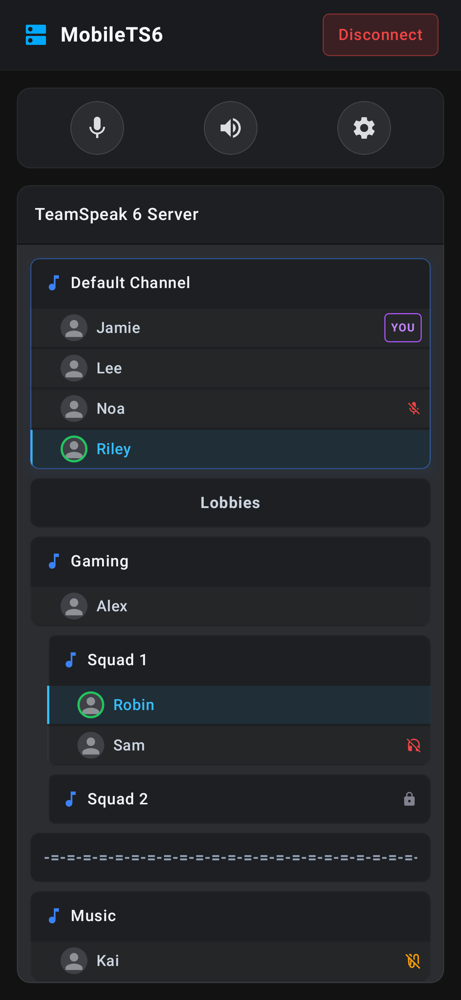

# MobileTS6

A TeamSpeak client for Android. Type a nickname and a server address, and the app connects straight to the
TeamSpeak server: no bridge, tunnel or proxy in between. It works with TeamSpeak 6 and TeamSpeak 3 servers.

**Status: early.** It connects, shows the channels and who is in them (in WebTS's style), lets you change channels,
and plays voice. Talking (microphone, push-to-talk), chat and the rest are coming next.



The TeamSpeak connection is a Kotlin version of the one in [WebTS](https://github.com/KorppuJauho/webts), the
self-hosted web client for TeamSpeak.

## Building

Everything builds in Docker, so the only things needed are Docker and a Bash shell (on Windows: Docker inside
WSL). There's no need to install Java or the Android SDK.

```bash
ACCEPT_ANDROID_SDK_LICENSE=yes scripts/dev.sh image   # the build image: Java and the Android SDK (once)
scripts/dev.sh test                                   # tests
scripts/dev.sh apk                                    # a test build in dist/
scripts/dev.sh screenshots                            # pictures of the screens (example data) in docs/screenshots/
```

The build image accepts the Android SDK license, which is why that variable has to be set.

### Testing on a phone

`scripts/dev.sh devserver up` starts a small page on port 8686. Open `http://<this computer's address>:8686` on the
phone, tap the newest build and install it. Android asks once to allow installing apps from the browser.

Test builds send their log to that page (`dist/phone.log`) when `DEV_LOG_URL` is set in `dev.env`. Release builds
never do.

### Tests against a real server

`scripts/dev.sh it` connects two clients to a TeamSpeak server and checks the following:

- they see each other and each other's channel moves
- one hears exactly what the other sends
- chat messages arrive
- both leave cleanly

Put the test server's address in `dev.env` as `TS_TEST_SERVER=host:port`. If the server runs in a container, add
`TS_CONTAINER=<name>` as well, so `scripts/dev.sh ts-server up` and `down` can start and stop it.

`dev.env` holds this computer's own settings and is never committed.

## License

[Open Software License 3.0](LICENSE).
