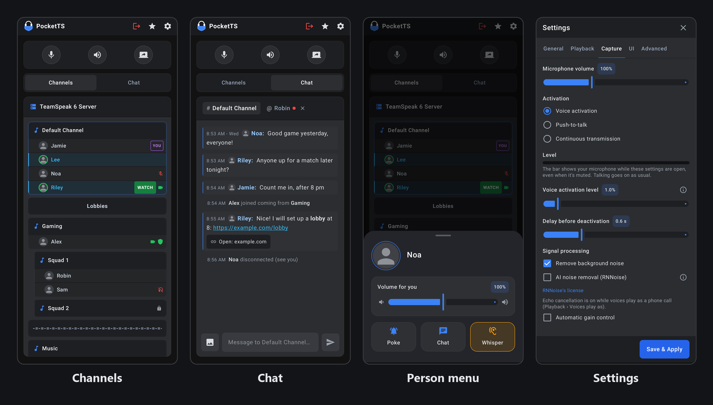

# PocketTS

A free, unofficial TeamSpeak client for Android, made for TeamSpeak 6 servers. Type a nickname and a server address
to join.

**[Get it on Google Play](https://play.google.com/store/apps/details?id=io.github.korppujauho.pocketts)**, or download
the APK from [GitHub Releases](https://github.com/KorppuJauho/pocketts/releases). Android 10 or newer.

## What it does

- **Voice:** voice activation or push-to-talk, whispering, and echo and noise removal. Keeps working with the screen
  off.
- **Streams:** watch others' screen and camera streams, small over the channels or on the full screen, and share
  your own camera or screen.
- **Chat:** channel and private chats, with pictures and pokes.
- **Channels and files:** who is where, and each channel's files.
- **Connecting** by address, server nickname, TeamSpeak link or invite, with favourites in folders.
- **Admin tools** (optional): move, kick and ban people, and edit channels.
- **Fifteen languages** (see [TRANSLATIONS.md](TRANSLATIONS.md); corrections welcome).

Your TeamSpeak identity and saved passwords are encrypted on the phone. No account, no ads, no tracking (see the
[privacy policy](PRIVACY.md)). The GitHub version asks GitHub once a day whether there's a newer version (you can turn
that off in Settings).

**Status:** young, and public on Google Play since November 2026. See the [changelog](CHANGELOG.md), and the
[issues](https://github.com/KorppuJauho/pocketts/issues) for what's planned. Questions, ideas and tips are welcome in
the [discussions](https://github.com/KorppuJauho/pocketts/discussions); bugs go to the issues, where a debug log
(Settings › Advanced › Debug log, with names and addresses taken out) helps with bugs that are hard to repeat.
Security problems: please report them privately, see [SECURITY.md](SECURITY.md).

## Install

PocketTS needs Android 10 or newer.

### Google Play

Install [PocketTS from Google Play](https://play.google.com/store/apps/details?id=io.github.korppujauho.pocketts).
It gets its updates from there. If you have the GitHub version, the Play version installs over it and keeps your
settings.

### GitHub

Download the APK from [Releases](https://github.com/KorppuJauho/pocketts/releases) and open it on your phone.
Android asks once to allow installing apps from your browser.

## Known limitations

- **No myTeamSpeak features.** PocketTS doesn't use myTeamSpeak, TeamSpeak's account service, so what goes through
  it isn't available: 1:1 voice calls, group chats, and pictures shared through myTeamSpeak by the TeamSpeak app.
- **Pictures go to the server's own files.** PocketTS can't upload pictures to TeamSpeak's picture service. The
  pictures you send are saved in the channel's files on the server (file transfer), so you need permission to upload
  files in that channel. TeamSpeak app users see them as usual.

## Building it yourself and contributing

See [DEVELOPING.md](DEVELOPING.md) for building, and [CONTRIBUTING.md](CONTRIBUTING.md) before opening a pull request.

## Credits

The people who have helped are in [CREDITS.md](CREDITS.md).

## License

[GNU General Public License v3.0](LICENSE). You're welcome to fork PocketTS, change it and share your version, as
long as you share its source code under the same license.

The PocketTS name and icon are mine. If you release your own version as an app (in an app store or as your own
downloads), give it a different name and icon so nobody mistakes it for PocketTS.

PocketTS isn't affiliated with or endorsed by TeamSpeak Systems GmbH. TeamSpeak is their trademark.

If you'd like to say thanks, you can [buy me a coffee](https://buymeacoffee.com/jauho).
